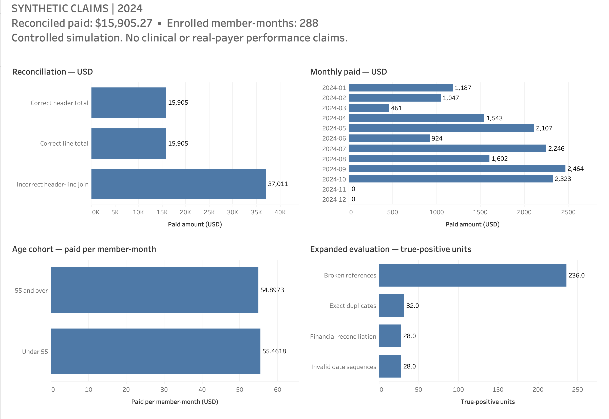

# Claims Quality & Reconciliation

Summing claim-header payments after joining them to service lines overstated the synthetic paid total by 132.7%. The join reported $37,011.02. The reconciled total is $15,905.27, an overstatement of $21,105.75. Each header payment repeats once for every service line under it.

Nothing errors when this happens. The query runs and the total looks believable. This project builds SQL and Python checks that catch that error, along with exact duplicate records, broken links between tables and dates in the wrong order. Header payments, summed line payments and a join that keeps one row per claim all give the same reconciled total. `SUM(DISTINCT paid_cents)` is not a fix, because two different claims can carry the same amount.

Every check was tested on copies of the data with planted defects, including valid records made to look like defects. Across 18 scenarios on 4 generated datasets each (72 runs), every check caught all of its planted defects with no false alarms: 32 exact duplicates, 236 broken links, 28 invalid date sequences and 28 payment reconciliation failures. Each count is a row flagged by one check in one run, not a count of claims or patients.

All data are synthetic. No real members, providers, payers or employer data are used.



Tableau dashboard built on the reconciled baseline. Open `dashboard/Claims_Quality_Public.twbx` in Tableau Desktop or Tableau Public. The extract is packaged with it, so no account or upload is needed. Units and interactions are in the [dashboard notes](dashboard/README.md).

## Run it

Requires Python 3.11+.

```sh
python3 -m venv .venv
.venv/bin/python -m pip install -r requirements-dev.txt
.venv/bin/python -m pytest -q
PYTHONPATH=src .venv/bin/python -m claims_quality run --seed 17 --scenario standard --out work/run-17
```

`run` generates the data, runs the checks, and writes the flags, an `ISSUES.md` review queue, the evaluation metrics and the join analysis. The [technical notes](docs/TECHNICAL_NOTES.md) describe each output. The [architecture](docs/ARCHITECTURE.md) covers the other commands.

Results: [validation summary](reports/VALIDATION_SUMMARY.md), [measured results](reports/RESULTS.md), [expanded evaluation](reports/expanded/EXPANDED_RESULTS.md), [executive brief](reports/EXECUTIVE_BRIEF.md).

## Limitations

The dataset is small and fixed so every expected result can be checked exactly. It says nothing about scale, and results on these generated cases do not estimate performance on real claims.

November and December show zero claims because the generator creates service dates only in the first 300 days of 2024. Cohort, provider and monthly differences also come from the generator.

Claims are counted as claims, not visits. Payment lags are fixed, not modeled. Real adjudication, payer rules, clinical validation and fraud detection are out of scope. The full list is in [limitations](docs/LIMITATIONS.md).

## Reference

| Table | Grain |
|---|---|
| `members` | One row per member_id |
| `providers` | One row per provider_id |
| `enrollment` | One row per enrollment_id |
| `claim_headers` | One row per claim_id |
| `claim_lines` | One row per claim_id + line_number |

Money is stored as integer cents so totals reconcile exactly. Exact duplicates repeat every business field, identifiers included. Utilization uses enrollment denominators: member-months count each enrolled member and calendar month once, and cohort rates divide summed numerators by summed denominators.

[Data dictionary](docs/DATA_DICTIONARY.md) · [Metric definitions](docs/METRIC_DEFINITIONS.md) · [Validation protocol](docs/VALIDATION.md)
